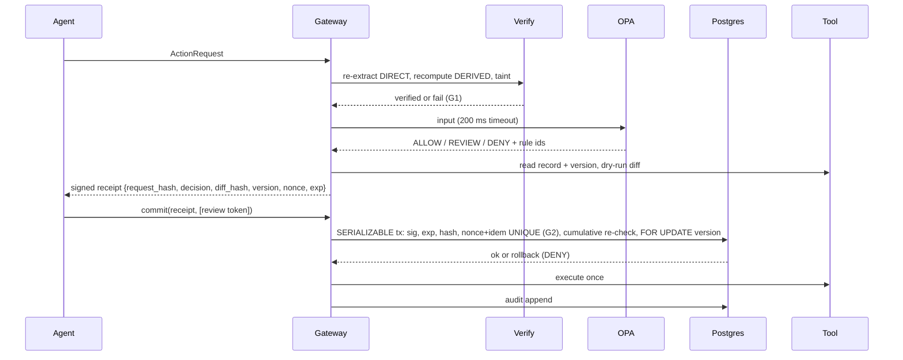

# Architecture

**USP: Proof before permission.** G1: no value authorizes a write unless its derivation re-checks. G2: no approval can be replayed.

## The five steps as components
| Step (slide 3) | Component | Module |
|---|---|---|
| 1 Intercept | MCP proxy in front of every tool, default deny | `server.py`, `adapters/langchain.py` |
| 2 Verify | re-extract cited values, recompute derived, check taint | `extract.py`, `verify.py` |
| 3 Authorize | OPA/Rego + dry-run diff + state version | `policy.py`, `policy/actionproof.rego`, `gate.prepare` |
| 4 Receipt and commit | signed one-use receipt; commit re-checks state, then calls the tool | `gate.py` |
| 5 Audit | hash-chained log, signed checkpoints, verifier CLI | `audit.py` |

## Trust boundaries
| Zone | Trusted? | Notes |
|---|---|---|
| Agent / LLM / documents | **No** | everything it sends is data; document text is tainted |
| Gateway process (gate) | Yes | holds the Ed25519 key (ADR-007) |
| OPA sidecar | Yes | reached only by the gateway |
| PostgreSQL | Yes | UNIQUE constraints enforce G2 |
| Upstream tools / mocks | No | may be hostile: stale versions, retries, double calls |

## prepare / commit sequence

## Stack (slide 7) and reasons
| Layer | Choice | Reason |
|---|---|---|
| Gateway | Python, FastAPI, MCP SDK | official MCP SDK; thin |
| Contracts | Pydantic v2 strict, RFC 8785 | typed, canonical bytes to hash and sign |
| Policy | OPA sidecar, Rego | declarative default-deny, `opa test` |
| Evidence | pdfplumber + raster/OCR | two independent readers must agree (ADR-002) |
| State | PostgreSQL | serializable tx, UNIQUE constraints (ADR-001) |
| Signing | Ed25519 (PyNaCl) | small, deterministic signatures |
| Agent adapter | LangChain wrapper | existing agents (ADR-004) |
| Console | Next.js + React | source-span review UI |

Updated again in Phases 3, 5, 7.
