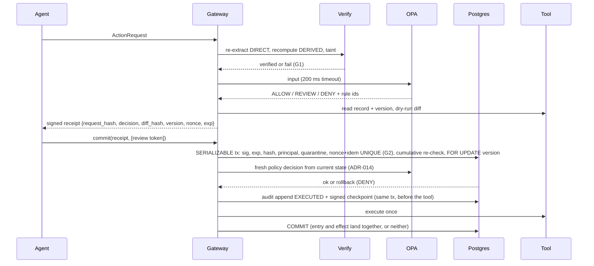

# Architecture

**USP: Proof before permission.** G1: no value authorizes a write unless its derivation re-checks. G2: no approval can be replayed.

## The five steps as components
| Step (slide 3) | Component | Module |
|---|---|---|
| 1 Intercept | MCP proxy in front of every tool, default deny | `server.py`, `adapters/langchain.py` |
| 2 Verify | re-extract cited values, recompute derived, check taint | `extract.py`, `verify.py` |
| 3 Authorize | OPA/Rego + dry-run diff + state version | `policy.py`, `policy/actionproof.rego`, `gate.prepare` |
| 4 Receipt and commit | signed one-use receipt; commit re-checks state, then calls the tool | `gate.py` |
| 5 Audit | hash-chained log, signed checkpoints, verifier CLI | `audit.py` |

## Trust boundaries
| Zone | Trusted? | Notes |
|---|---|---|
| Agent / LLM / documents | **No** | everything it sends is data; document text is tainted |
| Gateway process (gate) | Yes | holds the Ed25519 key (ADR-007) |
| OPA sidecar | Yes | reached only by the gateway |
| PostgreSQL | Yes | UNIQUE constraints enforce G2 |
| Upstream tools / mocks | No | may be hostile: stale versions, retries, double calls |

## prepare / commit sequence

## Phase 3 status: gate as built (`src/actionproof/gate.py`)
`Gate(settings, signer, conn_factory, tool, docs_provider=None)` with four public methods: `prepare`, `commit`
(agent-facing, through the transport) and `mint_review_token`, `release_quarantine` (human/admin side only; no
tool-facing path may expose them). Nothing else is public and the Signer never leaves it
(`tests/usp/test_key_isolation.py`).

Identity (ADR-012): the transport (MCP session / adapter, Phase 5) authenticates the caller and passes a
`Principal(actor, on_behalf_of)`; it is a required keyword argument of `prepare` and `commit` (no default), and the
request's `actor`/`on_behalf_of` must equal it exactly, else AP-SCOPE-02 / G1. Ids are canonical
(`^[a-z0-9][a-z0-9_.-]{0,63}$`, contracts.py).

**`prepare(req, docs=None, *, principal) -> PrepareResult(decision, reasons, verify, diff, receipt)`** never raises (AP-ERR-11):
1. strict parse (`contracts.parse_request`); request not bound to `principal` = AP-SCOPE-02; unknown tool or
   missing `invoice_id` = AP-VER-01.
2. `sor = tool.sor_for(invoice_id)` (PO total, vendor) from the ERP records, never from the agent.
3. `verify.verify_request(req, docs, sor)` (variance pinned to `DERIVED sub(invoice.total, po.total)`, ASSERTED
   never a derivation input, ADR-013); then the gate requires `amount`, `invoice.total`, `po.total` and `variance`
   to equal the system-of-record values (ADR-011/013). Any failure = AP-VER-01 (G1).
4. `tool.read_record("invoice:<id>") -> (data, version)`; record not `open` = AP-STALE-07; record quarantined
   (ADR-014) = AP-REP-05.
5. policy input: verify result, `amount`/`variance` claims, `vendor_id` from the record, scope from `delegations`
   (missing row = empty scope), committed `SUM(amount)` for actor+vendor; `policy.decide` (OPA, 200 ms, fail closed).
6. DENY -> no diff, no receipt. ALLOW/REVIEW -> `diff = tool.dry_run(req)`, receipt payload
   `{request_hash, decision, reasons, diff_hash, record_id, version, nonce, exp, tool, actor, on_behalf_of,
   idempotency_key}` signed Ed25519 over RFC 8785 bytes. `diff_hash = sha256(JCS({diff, before: record data}))`.
`PrepareResult.card()` renders deck slide 1.

**`commit(receipt, req, review_token=None, *, principal) -> CommitResult(outcome, reasons, tool_result)`**, outcome
`EXECUTED` or `DENY`, checked in this order:

| # | Check | DENY rule |
|---|---|---|
| 1 | signature (and exact payload keys) | AP-SIG-09 G2 |
| 2 | `now < exp` | AP-EXP-06 G2 |
| 3 | re-validate the request (`parse_request(req.model_dump())`, even for an ActionRequest instance), then `request_hash(req) == payload.request_hash` | AP-HASH-08 G2 |
| 3b | request `actor`/`on_behalf_of` == `principal` (ADR-012) | AP-SCOPE-02 G1 |
| 4 | REVIEW needs a token | AP-REV-10 G2 |
| — | open one connection, SERIALIZABLE; `LOCK TABLE commits IN SHARE ROW EXCLUSIVE MODE` before any snapshot | |
| 4b | record not in `quarantine` (ADR-014) | AP-REP-05 G2 |
| 5 | REVIEW: atomic `UPDATE review_tokens ... used_at IS NULL AND exp > now RETURNING` | AP-REV-10 (other hash / unknown), AP-REP-05 (used), AP-EXP-06 (expired) |
| 5b | REVIEW: re-read `people` `FOR SHARE` for the token's `minted_by` and the bound Principal; reviewer role + different person (ADR-008) | AP-SEP-12 G2 (rollback, token unused) |
| 6 | `INSERT INTO commits` (UNIQUE nonce, idempotency_key) | AP-REP-05 G2 |
| 7 | `SUM(amount)` actor+vendor incl. this row `<= 5000.00` | AP-CUM-03 G1 |
| 8 | `SELECT ... FOR UPDATE` version == payload.version, and diff hash recomputed == payload.diff_hash | AP-STALE-07 G2 |
| 8b | **fresh policy** (ADR-014): rebuild the policy input from CURRENT state (delegation scope, PO total via `sor_for`, committed sum; amount and variance must still equal the records) and `policy.decide` again | fresh DENY: OPA's rules (G1); fresh REVIEW on an ALLOW receipt: AP-STALE-07 G2 |
| 9 | `tool.execute(req, version, idempotency_key, conn)` once; after it the version moved by at most one | AP-STALE-07 / AP-ERR-11 |
| 10 | gate sets `version = payload.version + 1`, COMMIT | |

40001/40P01 before step 9 are retried up to 3 times, then AP-ERR-11. After step 9 nothing is retried: the tx is
rolled back and the receipt is burned: its `commits` row and a `quarantine` row for the record are each inserted in
their own tx (ADR-010, ADR-014), so a retry is AP-REP-05 and no new receipt for that record can be prepared or
committed until `release_quarantine(record_id, reviewer)`. If a burn write fails, the DENY carries an extra
AP-ERR-11 reason.
The commit lock makes concurrent split payments deterministic: exactly one executes, the other is AP-CUM-03
(`tests/attacks/test_split_payments.py`, 20 rounds).

**`mint_review_token(receipt, req, *, reviewer_login) -> token`** (ADR-008), human side only. It checks the
receipt like commit steps 1-3 (AP-SIG-09 / AP-EXP-06 / AP-HASH-08), requires `decision == REVIEW` (AP-REV-10), reads
the submitter from `req` (actor, on_behalf_of), then applies AP-SEP-12 against `people`: the login needs the
`reviewer` role (`admin` cannot mint), and its `person_id` must differ from both submitter persons; any missing row
or a `team` on_behalf_of refuses. A refusal raises `ReviewRefused(reason)` and is an audit chain entry
(`mint`/`REFUSED`, own tx). The token row stores `minted_by` and `minted_by_person`; it is inserted in the same tx
as its `mint`/`MINTED` entry, so an audit failure refuses the mint (AP-ERR-11) and no token exists.

**Rule for the Phase 5 console backend:** `reviewer_login` is the authenticated server-side session subject and
nothing else. It is never read from a request body, form field, query string or header the browser controls, and
no MCP/adapter path may call `mint_review_token`. The approval label reads "requested by <actor> for
<on_behalf_of> · approved by <reviewer> (different person)".

## Phase 5 status: audit as built (`src/actionproof/audit.py`, deck S3.6 / S9.3)
Tables `audit_log` and `audit_checkpoints` (docs/DATA_MODEL.md), append-only by trigger (UPDATE/DELETE/TRUNCATE
raise). A superuser or the table owner can bypass the trigger; the chain and the signed checkpoints DETECT it.

- `audit.append(conn, kind, **fields)` in the caller's tx: takes the audit lock, reads the head, writes
  `seq = head + 1`, `prev_hash = head.entry_hash` (genesis `"0"*64`),
  `entry_hash = sha256(RFC 8785 {seq, ts, kind, request_hash, actor, on_behalf_of, record_id, decision, rules,
  detail, prev_hash})`. seq is assigned under the lock, not by a sequence (a sequence is not transactional, so a
  rolled-back commit entry would leave a gap).
- **Audit lock = `LOCK TABLE audit_log IN EXCLUSIVE MODE`, not `pg_advisory_xact_lock`.** The commit tx is
  SERIALIZABLE and appends late; it must own the lock before its snapshot or the head it reads can be stale.
  `SELECT pg_advisory_xact_lock()` takes the snapshot before it waits; `LOCK` takes none, so the gate calls
  `audit.lock` right after `LOCK TABLE commits`. Readers (the verifier) are not blocked.
- `audit.checkpoint(conn, signer)` signs `{seq, head_hash, ts}` with the gate Signer (receipt key; the key never
  leaves signing.py, ADR-007; the exact payload key sets keep receipts and checkpoints apart). The gate checkpoints
  every `AUDIT_CHECKPOINT_EVERY` entries (default 1, validated env) in the same tx as the entry.
- `python -m actionproof.audit verify [--public-key B64]` needs only `DATABASE_URL` and the PUBLIC key
  (`--public-key` or the file at `AUDIT_PUBLIC_KEY_PATH`, base64 of `Signer.public_key_b64()`); never the seed. One
  REPEATABLE READ read-only snapshot. Checks contiguous seq from 1, every `prev_hash` link, every `entry_hash`, and
  for every checkpoint: an entry exists at its seq, `head_hash` equals that entry's hash, the signature verifies.
  Prints `audit: OK (<n> entries, <m> checkpoints)` (exit 0) or `audit: FAILED at seq <k>: <reason>` (exit 1;
  an unreadable log is `FAILED at seq 0`); bad config is exit 2.

What the gate writes:

| Event | kind / decision | Transaction | If the audit write fails |
|---|---|---|---|
| prepare ALLOW / REVIEW | `prepare` / ALLOW, REVIEW (+ rules, nonce) | own short tx, before the receipt is returned | DENY AP-ERR-11, no receipt |
| prepare DENY | `prepare` / DENY | own short tx | still DENY (unchanged) |
| commit executes | `commit` / EXECUTED (nonce, idempotency key, amount, version, reviewer) | **inside** the commit tx, after every check, **before** `tool.execute` | tx rolls back, tool never called: DENY AP-ERR-11 |
| commit DENY (incl. burned) | `commit` / DENY + rules | own short tx after the rollback | still DENY |
| mint success | `mint` / MINTED (reviewer login + person) | same tx as the token row | mint refused AP-ERR-11, no token |
| mint refusal (AP-SEP-12, AP-SIG-09, ...) | `mint` / REFUSED + rule | own short tx | still refused |
| release_quarantine | `release_quarantine` / RELEASED or NOT_QUARANTINED (reviewer) | same tx as the DELETE | nothing released, error raised |

Entries never hold key material, review tokens, receipt signatures, exception messages or tracebacks
(`tests/test_audit.py::test_entries_hold_no_secrets`). Identity fields come from the signed receipt payload when
the receipt verified, else from the request's own (unverified) claim.

## Stack (slide 7) and reasons
| Layer | Choice | Reason |
|---|---|---|
| Gateway | Python, FastAPI, MCP SDK | official MCP SDK; thin |
| Contracts | Pydantic v2 strict, RFC 8785 | typed, canonical bytes to hash and sign |
| Policy | OPA sidecar, Rego | declarative default-deny, `opa test` |
| Evidence | pdfplumber + raster/OCR | two independent readers must agree (ADR-002) |
| State | PostgreSQL | serializable tx, UNIQUE constraints (ADR-001) |
| Signing | Ed25519 (PyNaCl) | small, deterministic signatures |
| Agent adapter | LangChain wrapper | existing agents (ADR-004) |
| Console | Next.js + React | source-span review UI |

Updated again in Phases 3, 5, 7.
