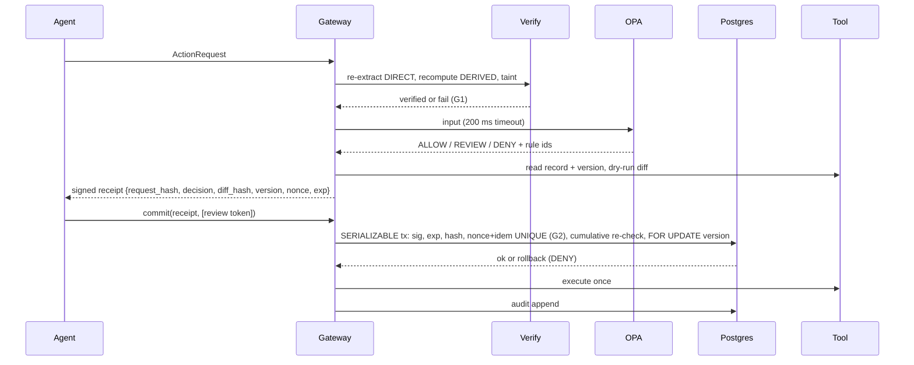

# Architecture

**USP: Proof before permission.** G1: no value authorizes a write unless its derivation re-checks. G2: no approval can be replayed.

## The five steps as components
| Step (slide 3) | Component | Module |
|---|---|---|
| 1 Intercept | MCP proxy in front of every tool, default deny | `server.py`, `adapters/langchain.py` |
| 2 Verify | re-extract cited values, recompute derived, check taint | `extract.py`, `verify.py` |
| 3 Authorize | OPA/Rego + dry-run diff + state version | `policy.py`, `policy/actionproof.rego`, `gate.prepare` |
| 4 Receipt and commit | signed one-use receipt; commit re-checks state, then calls the tool | `gate.py` |
| 5 Audit | hash-chained log, signed checkpoints, verifier CLI | `audit.py` |

## Trust boundaries
| Zone | Trusted? | Notes |
|---|---|---|
| Agent / LLM / documents | **No** | everything it sends is data; document text is tainted |
| Gateway process (gate) | Yes | holds the Ed25519 key (ADR-007) |
| OPA sidecar | Yes | reached only by the gateway |
| PostgreSQL | Yes | UNIQUE constraints enforce G2 |
| Upstream tools / mocks | No | may be hostile: stale versions, retries, double calls |

## prepare / commit sequence

## Phase 3 status: gate as built (`src/actionproof/gate.py`)
`Gate(settings, signer, conn_factory, tool, docs_provider=None)` with three public methods; nothing else is public
and the Signer never leaves it (`tests/usp/test_key_isolation.py`).

**`prepare(req, docs) -> PrepareResult(decision, reasons, verify, diff, receipt)`** never raises (AP-ERR-11):
1. strict parse (`contracts.parse_request`); unknown tool or missing `invoice_id` = AP-VER-01.
2. `sor = tool.sor_for(invoice_id)` (PO total, vendor) from the ERP records, never from the agent.
3. `verify.verify_request(req, docs, sor)`; then the gate requires `amount`, `invoice.total`, `po.total` claims to
   equal the system-of-record values (ADR-011). Any failure = AP-VER-01 (G1).
4. `tool.read_record("invoice:<id>") -> (data, version)`; record not `open` = AP-STALE-07.
5. policy input: verify result, `amount`/`variance` claims, `vendor_id` from the record, scope from `delegations`
   (missing row = empty scope), committed `SUM(amount)` for actor+vendor; `policy.decide` (OPA, 200 ms, fail closed).
6. DENY -> no diff, no receipt. ALLOW/REVIEW -> `diff = tool.dry_run(req)`, receipt payload
   `{request_hash, decision, reasons, diff_hash, record_id, version, nonce, exp, tool, actor, on_behalf_of,
   idempotency_key}` signed Ed25519 over RFC 8785 bytes. `diff_hash = sha256(JCS({diff, before: record data}))`.
`PrepareResult.card()` renders deck slide 1.

**`commit(receipt, req, review_token=None) -> CommitResult(outcome, reasons, tool_result)`**, outcome
`EXECUTED` or `DENY`, checked in this order:

| # | Check | DENY rule |
|---|---|---|
| 1 | signature (and exact payload keys) | AP-SIG-09 G2 |
| 2 | `now < exp` | AP-EXP-06 G2 |
| 3 | `request_hash(req) == payload.request_hash` | AP-HASH-08 G2 |
| 4 | REVIEW needs a token | AP-REV-10 G2 |
| — | open one connection, SERIALIZABLE; `LOCK TABLE commits IN SHARE ROW EXCLUSIVE MODE` before any snapshot | |
| 5 | REVIEW: atomic `UPDATE review_tokens ... used_at IS NULL AND exp > now RETURNING` | AP-REV-10 (other hash / unknown), AP-REP-05 (used), AP-EXP-06 (expired) |
| 6 | `INSERT INTO commits` (UNIQUE nonce, idempotency_key) | AP-REP-05 G2 |
| 7 | `SUM(amount)` actor+vendor incl. this row `<= 5000.00` | AP-CUM-03 G1 |
| 8 | `SELECT ... FOR UPDATE` version == payload.version, and diff hash recomputed == payload.diff_hash | AP-STALE-07 G2 |
| 9 | `tool.execute(req, version, idempotency_key, conn)` once; after it the version moved by at most one | AP-STALE-07 / AP-ERR-11 |
| 10 | gate sets `version = payload.version + 1`, COMMIT | |

40001/40P01 before step 9 are retried up to 3 times, then AP-ERR-11. After step 9 nothing is retried: the tx is
rolled back and the receipt is burned (its `commits` row inserted in a separate tx), so a retry is AP-REP-05 (ADR-010).
The commit lock makes concurrent split payments deterministic: exactly one executes, the other is AP-CUM-03
(`tests/attacks/test_split_payments.py`, 20 rounds).

## Stack (slide 7) and reasons
| Layer | Choice | Reason |
|---|---|---|
| Gateway | Python, FastAPI, MCP SDK | official MCP SDK; thin |
| Contracts | Pydantic v2 strict, RFC 8785 | typed, canonical bytes to hash and sign |
| Policy | OPA sidecar, Rego | declarative default-deny, `opa test` |
| Evidence | pdfplumber + raster/OCR | two independent readers must agree (ADR-002) |
| State | PostgreSQL | serializable tx, UNIQUE constraints (ADR-001) |
| Signing | Ed25519 (PyNaCl) | small, deterministic signatures |
| Agent adapter | LangChain wrapper | existing agents (ADR-004) |
| Console | Next.js + React | source-span review UI |

Updated again in Phases 3, 5, 7.
